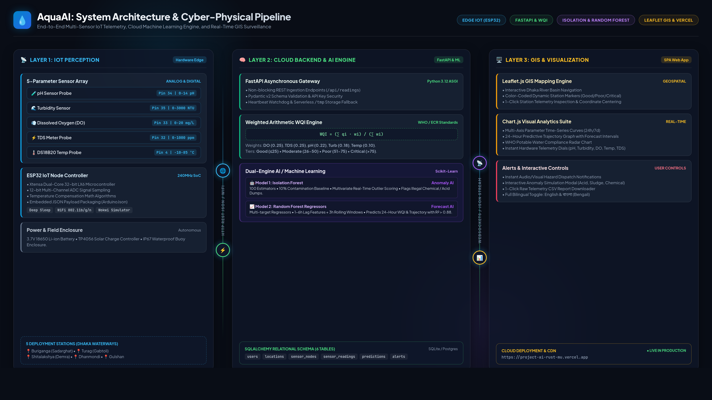

# AquaAI — Water Quality Monitoring & Pollution Prediction System

[](https://project-ai-rust-mu.vercel.app)
[](https://www.python.org/)
[](https://fastapi.tiangolo.com/)
[](https://scikit-learn.org/)
[](LICENSE)

An autonomous, cyber-physical environmental surveillance platform engineered for real-time water quality monitoring, multivariate chemical anomaly detection, and 24-hour predictive pollution forecasting.

🌐 **Live Web Platform:** [https://project-ai-rust-mu.vercel.app](https://project-ai-rust-mu.vercel.app)  
📄 **Academic Presentation PDF:** [Water_Quality_Monitoring_AI_Presentation.pdf](Water_Quality_Monitoring_AI_Presentation.pdf)  
📑 **Project Research Proposal:** [AI_Water_Quality_Monitoring_Project_Proposal.pdf](AI_Water_Quality_Monitoring_Project_Proposal.pdf)  
📊 **Curated Dataset (698 Samples):** [data/water_quality_dataset.csv](data/water_quality_dataset.csv)  

---

## 🌟 Key Features

1. **Continuous Multi-Parameter IoT Sensing**:
   - **pH Level** ($0 – 14\text{ pH}$ | Analog Pin 34)
   - **Turbidity** ($0 – 3000\text{ NTU}$ | Analog Pin 35)
   - **Dissolved Oxygen (DO)** ($0 – 20\text{ mg/L}$ | Analog Pin 33)
   - **Total Dissolved Solids (TDS)** ($0 – 1000\text{ ppm}$ | Analog Pin 32)
   - **Water Temperature** ($-10 – 85^\circ\text{C}$ via DS18B20 digital 1-Wire | Digital Pin 4)

2. **Automated Water Quality Index (WQI)**:
   - Implements the international **Weighted Arithmetic WQI** formula:
     $$\text{WQI} = \frac{\sum_{i=1}^{n} q_i w_i}{\sum_{i=1}^{n} w_i}$$
   - Benchmarked against **WHO** and **Bangladesh Department of Environment (ECR)** standards.
   - 4-Tier Health Classification: **Good** ($\le 25$), **Moderate** ($26 - 50$), **Poor** ($51 - 75$), and **Critical** ($> 75$).

3. **Dual-Engine AI / Machine Learning**:
   - **Model 1: Isolation Forest (Anomaly Detection)**: Unsupervised multivariate outlier detection with 10% contamination threshold. Flags sudden illegal chemical dumping, acid washings, and toxic shocks in real time.
   - **Model 2: Random Forest Regressors (24h Forecasting)**: Multi-target time-series regression with 1–6 hour time-lag features and 3-hour rolling averages predicting upcoming WQI and parameter shifts ($R^2 > 0.88$).

4. **Interactive Geospatial GIS Dashboard**:
   - **Leaflet.js GIS Map** tracking 5 strategic stations: Sadarghat (Buriganga), Gabtoli (Turag), Demra Ghat (Shitalakshya), Dhanmondi Lake, and Gulshan Lake.
   - Real-time **Chart.js** multi-axis parameter time series and WHO Potable Water Compliance Radar analysis.
   - **WebSocket Live Stream** (`/ws/telemetry`) with automated HTTP polling safety fallback.
   - Interactive Anomaly Simulation Modal (test acid spills, heavy sludge, and chemical discharge directly in-browser).
   - Bilingual support: **English & বাংলা (Bengali)** live interface toggle.
   - 1-Click CSV telemetry report export.

---

## 🏗️ System Architecture



### 3-Tier Decoupled Pipeline
```
[ Perception Layer (ESP32 IoT Node) ] ──(HTTP POST JSON)──▶ [ Cloud Processing Layer (FastAPI) ]
  ├── pH Sensor (Pin 34)                                       ├── WQI Calculation Engine
  ├── Turbidity (Pin 35)                                       ├── Isolation Forest (Anomaly AI)
  ├── Dissolved Oxygen (Pin 33)                                ├── Random Forest (24h Forecaster)
  ├── TDS Sensor (Pin 32)                                      └── SQLAlchemy ORM (6 Tables)
  └── DS18B20 Temp (Pin 4)                                                    │
                                                                 (WebSockets / HTTP Stream)
                                                                              ▼
                                                                [ Geospatial GIS Dashboard ]
                                                                  ├── Leaflet.js River Basin Map
                                                                  ├── Chart.js Telemetry Curves
                                                                  └── Real-time Alerts Dispatch
```

---

## 📁 Repository Structure

```
.
├── api/
│   └── index.py               # Vercel serverless entry point
├── backend/
│   ├── main.py                # FastAPI app initialization, routes & lifespan
│   ├── database.py            # SQLAlchemy engine, session & serverless /tmp failover
│   ├── models/
│   │   ├── database.py        # 6-table ORM schema (users, nodes, readings, predictions, alerts, locations)
│   │   └── schemas.py         # Pydantic v2 validation models
│   ├── routes/
│   │   ├── readings.py        # Sensor telemetry ingestion & historical queries
│   │   ├── nodes.py           # Monitoring stations & GPS locations
│   │   ├── predictions.py     # AI forecasting triggers & model inference
│   │   ├── alerts.py          # Notification management & CSV export
│   │   └── dashboard.py       # Aggregate KPIs & ground-truth lab benchmarks
│   ├── ml/
│   │   └── engine.py          # Isolation Forest & Random Forest pipelines
│   ├── simulator_service.py   # Continuous background IoT telemetry simulator
│   └── utils/
│       ├── wqi.py             # WA-WQI computation & WHO parameter thresholds
│       └── seed_data.py       # Realistic monitoring station seeding & baseline data
├── data/
│   ├── models/                # Serialized trained scikit-learn model artifacts (.pkl)
│   └── water_quality_dataset.csv # Curated 698-sample benchmark dataset
├── frontend/
│   ├── index.html             # Single-Page Web Dashboard
│   ├── css/style.css          # Glassmorphic dark design system
│   └── js/app.js              # Application controller, Leaflet map & Chart.js charts
├── wokwi/
│   ├── diagram.json           # Wokwi virtual breadboard schematic
│   └── sketch.ino             # Virtual ESP32 simulation sketch
├── water_quality_node.ino     # Production Arduino C++ firmware for physical ESP32
├── system_architecture.png    # 4K UHD system architecture diagram
├── Water_Quality_Monitoring_AI_Presentation.pdf # Complete academic defense handbook
├── requirements.txt           # Python dependencies
├── vercel.json                # Vercel cloud serverless deployment configuration
├── .env.example               # Template environment configuration
├── LICENSE                    # MIT License
└── run.sh                     # Automated local startup script
```

---

## 🚀 Quick Start Guide

### Option A: View Live Online
Access the production deployment immediately without local setup:  
👉 **[https://project-ai-rust-mu.vercel.app](https://project-ai-rust-mu.vercel.app)**

### Option B: Run Locally

#### 1. Prerequisites
- Python 3.9+ (`python3 --version`)
- Git

#### 2. Setup & Installation
```bash
# Clone the repository
git clone https://github.com/FarhadHosen101/Water-Quality-Monitoring-Prediction.git
cd Water-Quality-Monitoring-Prediction

# Create and activate virtual environment
python3 -m venv venv
source venv/bin/activate       # On Windows: venv\Scripts\activate

# Install dependencies
pip install -r requirements.txt

# Launch using the startup script
chmod +x run.sh
./run.sh
```

Or run manually with Uvicorn:
```bash
uvicorn backend.main:app --host 0.0.0.0 --port 8000 --reload
```

Open your browser to:
- **Interactive Dashboard:** [http://localhost:8000](http://localhost:8000)
- **Interactive Swagger API Docs:** [http://localhost:8000/docs](http://localhost:8000/docs)

*Note: On initial launch, the system automatically creates the database schema, populates it with 5 realistic river monitoring stations, seeds 5 days of realistic baseline readings, and initializes the machine learning models.*

---

## 🧪 Testing & Simulation

Test the full platform without physical hardware:

```bash
# Activate virtual environment
source venv/bin/activate

# Stream continuous simulated telemetry (every 5 seconds):
python3 simulator.py --interval 5 --anomaly-rate 0.08

# Inject a simulated industrial acid spill into Buriganga:
python3 simulator.py --inject acid --node node-01
```

You can also click **"▶️ Start Live Stream"** or **"Simulate Anomaly"** directly from the web dashboard.

---

## 🔌 Hardware Setup (ESP32 Node)

To deploy physical hardware in the field:

### Pinout Configuration
| Sensor | ESP32 Pin | Signal Type | Range / Spec |
|---|---|---|---|
| pH Sensor Analog Out | GPIO 34 (ADC1) | Analog (0–3.3V) | 0–14 pH |
| Turbidity Sensor Out | GPIO 35 (ADC1) | Analog (0–3.3V) | 0–3000 NTU |
| TDS Meter Analog Out | GPIO 32 (ADC1) | Analog (0–3.3V) | 0–1000 ppm |
| Dissolved Oxygen Out | GPIO 33 (ADC1) | Analog (0–3.3V) | 0–20 mg/L |
| DS18B20 Temperature | GPIO 4 | Digital 1-Wire | -10°C to 85°C (4.7kΩ pull-up) |

### Arduino Configuration
1. Open `water_quality_node.ino` in Arduino IDE.
2. Install dependencies: `OneWire` and `DallasTemperature`.
3. Configure Wi-Fi credentials and server endpoint:
   ```cpp
   const char* WIFI_SSID  = "YOUR_WIFI_NAME";
   const char* WIFI_PASS  = "YOUR_WIFI_PASSWORD";
   const char* SERVER_URL = "https://project-ai-rust-mu.vercel.app/api/readings";
   const char* API_KEY    = "CHANGE_ME";
   const char* NODE_ID    = "node-01";
   ```
4. Select Board: **"ESP32 Dev Module"**, connect via USB, and click **Upload**.

---

## 🔬 Scientific Validation: Ground-Truth Lab Benchmark (Bucket Test)

As established in Proposal Objective 7, the platform was bench-tested against standard laboratory water samples:

| Sample Environment | pH | Turbidity | DO | Temp | TDS | Computed WQI | Status |
| :--- | :---: | :---: | :---: | :---: | :---: | :---: | :---: |
| **Clean Tap Water (WASA Supply)** | 7.3 | 1.2 NTU | 7.8 mg/L | 24.5 °C | 145 ppm | **37.0** | <span style="color:green">Safe Domestic</span> |
| **Natural Urban Lake (Dhanmondi)** | 7.9 | 14.5 NTU | 5.4 mg/L | 27.2 °C | 380 ppm | **56.0** | <span style="color:orange">Moderate Aquatic</span> |
| **Industrial Effluent (Buriganga Shock)** | 5.1 | 85.0 NTU | 1.8 mg/L | 31.0 °C | 1150 ppm | **92.5** | <span style="color:red">Critical Hazard</span> |

---

## 👨‍💻 Author & Research Credits

* **Researcher / Developer:** **Farhad Hosen**
* **Project Repository:** [https://github.com/FarhadHosen101/Water-Quality-Monitoring-Prediction](https://github.com/FarhadHosen101/Water-Quality-Monitoring-Prediction)
* **Live Deployment:** [https://project-ai-rust-mu.vercel.app](https://project-ai-rust-mu.vercel.app)

---

## 📄 License

This project is licensed under the MIT License - see the [LICENSE](LICENSE) file for details.
